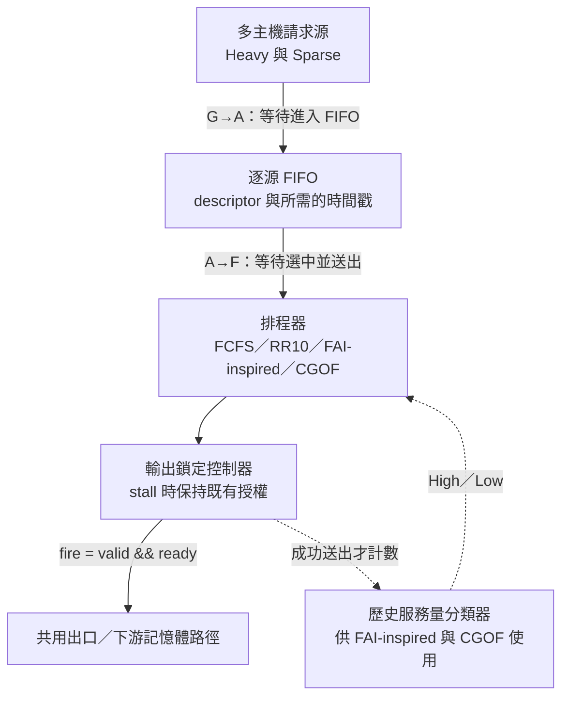
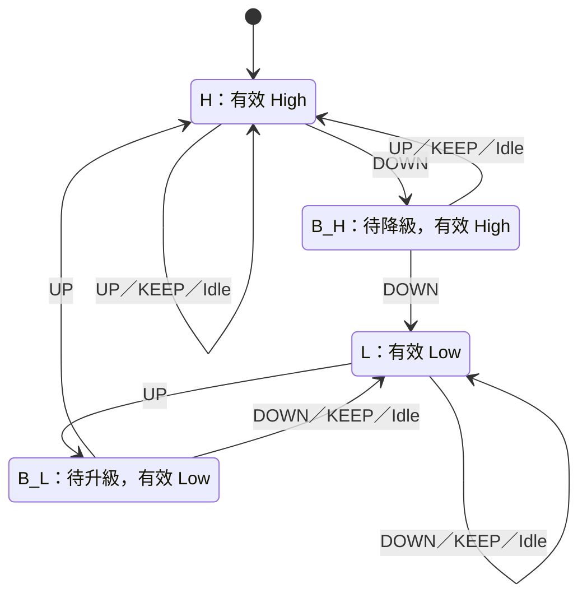
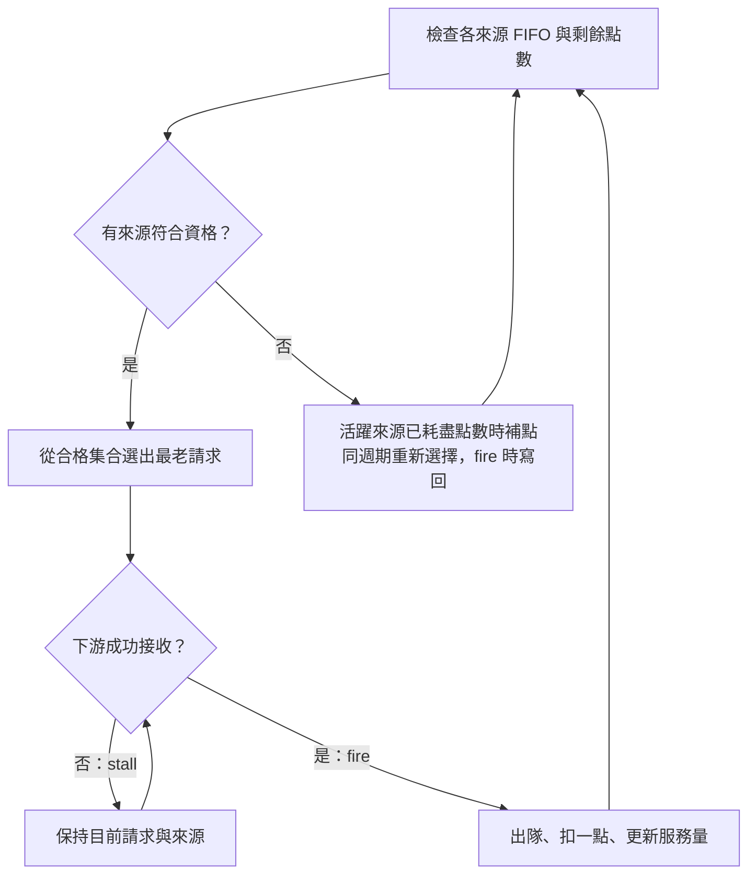

# CXL Switch Scheduler

[English](README.md) · **繁體中文**

**最新研究報告：**[閱讀 v5 完整 PDF（15 頁）](output/pdf/cxl-scheduler-humanized-20261111.pdf) · [原始碼與驗收紀錄](docs/final-report/README.md)｜2026 年 11 月 11 日文字潤稿版。

**多裝置工作：**[下載、更新與還原隨附研究資料](docs/sync/README.md) · [進度報告索引](docs/progress-reports/README.md)。

**以逐源點數改善 CXL 記憶體池的排程公平性與尾端延遲。**

多台主機共用記憶體池時，一個持續送出請求的大戶，可能讓其他偶爾發出請求的主機等上很久。這個專案從 FAI-CXL 的歷史服務量分類出發，建立可綜合的排程器與逐週期驗證平台，再提出 **CGOF（Credit-Gated Oldest-First，逐源點數最老優先）**：把服務配額從「整個優先類別」改成「每一個來源」，降低零星請求的等待，同時量測對大戶完工時間與硬體成本的影響。

在分類器完成訓練的 N4、20-seed RTL 確認實驗中，CGOF（2:1）將零星請求的 P99 等待時間，從 FAI-inspired 的 **10.00 降至 1.10 cycles**；突發流量則從 **21.05 降至 12.35 cycles**。N4 的合成 cell area 也略低於 FAI-inspired。

## 專案內容

| 目錄 | 內容 |
| --- | --- |
| [`rtl/`](rtl/) | SystemVerilog 排程器、共用 FIFO 與輸出鎖定控制器 |
| [`refc/`](refc/) | 獨立 Python 參考模型與測試 |
| [`sim/`](sim/) | cocotb 測試、流量情境與延遲記帳 |
| [`scripts/`](scripts/) | 回歸測試、實驗執行與統計分析 |
| [`specs/`](specs/) | 硬體規格與設計決策 |
| [`evidence/`](evidence/) | 實驗驗收紀錄與來源雜湊索引 |
| [`docs/`](docs/) | 研究推導、開發紀錄與後續實驗規劃 |

## 研究起點：保護零星請求，需要付出多少代價？

CXL 記憶體池讓多台主機透過交換器共用遠端記憶體，請求會在共用出口競爭服務機會。我們用兩種來源刻畫這個問題：

- **大戶（Heavy）**：持續產生大量請求，容易累積深佇列。
- **零星來源（Sparse）**：偶爾送出請求，或一次送出一小批；實驗分為獨立到達的 Arm A，以及每 1,024 cycles 突發 8 筆的 Arm B。

先來先服務（FCFS）讓零星請求排在大戶的積壓之後；固定輪詢能改善等待，但也會改變大戶的服務節奏。因此，我們同時觀察三件事：**零星請求的 P99 延遲、大戶的服務間隔與完工時間，以及排程器的面積與時序。**

### 共用硬體平台與延遲量測

各排程器共用 FIFO、輸出鎖定與下游握手邊界。平台涵蓋 N4／N8／N16，主要 FIFO 深度為 D16，請求使用 105-bit descriptor；FCFS 與歷史分類排程器保留到達時間戳，RR10 則省去這筆儲存。



每筆請求的等待分成兩段：

**G→F = G→A + A→F**

其中 G 是產生、A 是進入 FIFO、F 是成功送出。分開記帳，才能看出等待究竟發生在交換器外部，還是內部佇列。下游 `ready=0` 時，輸出控制器會保持已選中的請求；只有真正 `fire` 才能移除 FIFO 隊頭、扣點與更新服務量。

## 從 FAI-CXL 到 CGOF

### 1. 建立基準線：FCFS、RR10 與 BLISS-inspired

在 N4、20-seed、分類器完成訓練的 RTL 比較中，各策略的 Sparse G→F P99 如下。表中數值是各 seed P99 的平均，單位為 cycles。

| 排程器 | Arm A：獨立到達 | Arm B：突發到達 | 主要觀察 |
| --- | ---: | ---: | --- |
| FCFS | 18.10 | 33.45 | 零星請求容易等待大戶積壓 |
| RR10 | 11.00 | 17.70 | 每次造訪最多連發 10 筆，硬體最精簡 |
| BLISS-inspired | 1.15 | 33.00 | 獨立到達表現好，突發來源也可能觸發黑名單 |
| FAI-inspired（Main） | 10.00 | 21.05 | 依歷史服務量分類，再分配類別配額 |
| CGOF（2:1） | **1.10** | **12.35** | 將配額改為逐源點數 |

### 2. 重建 FAI 的分類器與 Buffer 語意

FAI-inspired 每隔一個視窗統計各來源成功送出的數量。令來源數為 N、來源 h 的服務量為 B[h]、總服務量為 S：

- `10 × N × B[h] < 3 × S`：產生 **UP** 證據，傾向提高優先級。
- `N × B[h] > S`：產生 **DOWN** 證據，傾向降低優先級。
- 其餘情況為 **KEEP**。

正式長視窗實驗使用 **W = 5,000,000 cycles（W5M）**；W256 用來快速觀察機制。硬體以整數比較實現門檻，不需要除法。

原論文正文與 Algorithm 2 對過渡狀態 Buffer 的處理不同，因此專案保留兩種實作：

| 情況 | Main：保留原優先級 | FAI-ImmBuf：立即切到目標優先級 |
| --- | --- | --- |
| 第一次出現反向證據 | 進入 Buffer，維持原有效類別 | 進入 Buffer，立即更換有效類別 |
| 下一窗仍有同方向證據 | 正式完成切換 | 完成狀態切換 |
| Buffer 中遇到 KEEP | 回到原穩定狀態 | 留在 Buffer |
| 單窗雜訊的有效類別翻轉 | 0 次 | 2 次 |

Main 的核心狀態轉移如下；High／Low 表示當下實際採用的優先級。



156 組狀態轉移重播與 720 組閉迴路模型實驗顯示，雙窗遲滯能濾除短暫雜訊，但持續角色反轉時也會多等一個視窗。另一方面，訓練後的 RTL 比較中，兩種 Buffer 語意的 Sparse P99 很接近：Arm A 都是 10.00，Arm B 分別為 21.05 與 21.35 cycles。**分類器穩定得快，不一定代表請求等得短；兩者需要分開量測。**

### 3. 找到瓶頸：類別配額受類別人數影響

Main 在 High 與 Low 類別之間使用 **10:10 配額**。當一個大戶為 Low、三個零星來源為 High，且所有來源持續積壓時：

| 機制 | Low 大戶 | 每個 High 來源 |
| --- | ---: | ---: |
| Main：兩類各拿 10 次服務 | 1/2 | 1/6 |
| CGOF（2:1）：逐源分配點數 | 1/7 | 2/7 |

類別拿到相同配額，並不代表類別裡的每台主機都得到合理份額。突發情境也會碰到同一問題：三個 High 來源同時各送 8 筆，共 24 筆請求，很快就會用完共用的 10 次服務配額，接著等待 Low 大戶的一輪服務。

### 4. CGOF：以逐源點數形成合格集合

CGOF 保留相同的歷史分類器，把點數直接綁定到來源。**FIFO 非空且點數大於零**的來源進入合格集合，再從中挑選最老的請求。每次成功送出，扣除該來源一點；所有活躍來源都用完點數後，再依有效類別補點。補點與選擇在同一次仲裁完成，不額外等待一個 cycle，點數狀態於成功送出時寫回。

- **CGOF（1:1）**：每個來源每輪一點，作為等權重控制組。
- **CGOF（2:1）**：High 每輪兩點，Low 每輪一點。



## 關鍵發現

### 逐源配額明顯降低訓練後的尾端延遲

在 seeds 529–548 的 N4 RTL 確認中，CGOF（2:1）相較 Main，Arm A 的平均 Sparse P99 減少 **8.90 cycles（89%）**，Arm B 減少 **8.70 cycles（約 41%）**；兩組都是 20／20 seeds 改善。

### 相對權重相同，絕對點數仍會改變等待

在跨越一個 W5M 邊界的有限大戶工作實驗中，所有來源仍為有效 High，CGOF（1:1）與（2:1）的相對權重因此相同，但 Sparse P99 分別是 **3 與 4 cycles**。兩點預算允許來源在同一輪多送一筆，改變補點週期與請求到達時的資格相位，進而影響尾端等待。

### 配額比合格集合內的排序更有影響

專案另外以 Eligible-RR 取代最老優先，拆開比較「逐源點數」與「集合內排序」：

- **W256、20 seeds、160 次 RTL 工作**：1:1 下兩種排序完全持平；2:1 下只有 7／20 seeds 改善一個 cycle，未達預先設定的確認門檻。
- **W5M、5 seeds、40 次 RTL 工作**：1:1-OF／1:1-RR／2:1-OF／2:1-RR 的 Sparse P99，每個 seed 都是 **11／11／12／11 cycles**；1:1 改用 RR 時，大戶最大服務間隔平均增加 1.6 cycles。

在這些情境裡，逐源配額是主要改善來源，集合內排序帶來較小的調整。

### 保護零星請求的代價，取決於剩餘容量

以 mixed／isolated 配對比較大戶完工時間，可以看出保護 Sparse 的成本：

| 負載情境 | 觀察結果 | 證據 |
| --- | --- | --- |
| Under：未飽和 | 20／20 seeds 的大戶額外完工時間為 0 cycles | W5M 模型 |
| Near：接近飽和 | 模型中的暫時落後可在觀察期追回；另一組有限工作 RTL 確認中，兩種 CGOF 的平均額外完工時間約為 3 cycles | 模型與 RTL 各自量測 |
| Over：超載 | 大戶平均增加 834.25 cycles 的完工時間 | W5M 模型 |

仍有空檔時，Sparse 能利用剩餘容量；需求超過出口容量後，這份保護就會成為大戶實際付出的時間。

### 面積與時序

在 SAED32、25 ns 目標週期的 pre-layout 合成與 PrimeTime STA 中，CGOF 的 N4／N8／N16、兩種權重共六組配置皆通過時序檢查。N4 的完整設計 cell area 如下，單位沿用合成報告的 library units：

| 排程器 | Cell area | 相較 Main |
| --- | ---: | ---: |
| FAI-inspired（Main） | 110,089.8 | 基準 |
| CGOF（2:1） | 109,794.8 | −0.27% |
| CGOF（1:1） | 106,163.1 | −3.57% |

RR10 省去時間戳與分類邏輯，面積比 FCFS／Main 小約 24%–28%；CGOF 則提供逐源配額與請求年齡選擇的能力。

## 實驗進度與下一步

目前已建立排程器 RTL、參考模型、逐週期比對、來源記帳與統計工具。多視窗動態角色切換的 **30 個 pilot 模型工作已通過**，Main 的 W5M RTL 錨點正進行乾淨來源重跑；20-seed 確認組依序通過錨點驗收後再推進。最新狀態見[實驗 backlog](docs/EXPERIMENTS_BACKLOG.md)。

| 後續方向 | 要回答的問題 |
| --- | --- |
| 多視窗角色切換 | 跨四個 W5M 視窗、主機角色反轉後，改善是否能在 20 seeds 重現？ |
| Under／Over RTL 配對 | 模型觀察到的容量吸收與超載代價，能否在 RTL 重現？ |
| CGOF 閘級功耗 | 逐源點數的功耗是多少？1:1 裁切未使用分類狀態後能省多少？ |
| 延遲恢復與規模 | 角色切換後多久恢復穩態？N8／N16 的有限工作表現如何？ |
| 定向 drain | 刻意在積壓中切斷生成時，排空順序與請求守恆是否正確？ |

結果以交換器排程邊界的 cycles 為單位；端到端 CXL.mem 延遲與應用程式效能留待系統模擬。各項數值的 RTL／模型來源整理在[結果與證據對照表](docs/final-report/update-20261102/CLAIM_EVIDENCE_MATRIX_20261102.md)。

## 開始使用

Python 模型與分析使用 Python 3.12；專案的 RTL 模擬環境為 Ubuntu WSL、Verilator 與 cocotb。依賴版本見 [`requirements-wsl.lock.txt`](requirements-wsl.lock.txt)。

執行模型與記帳測試：

```bash
python -m pytest -q refc/tests sim/experimental/test_diagnosis_source_book.py
```

在已設定好的 WSL 環境執行短視窗 RTL smoke：

```bash
source scripts/wsl_env.sh
python scripts/run_rtl_diagnosis.py --smoke --mode finite-heavy --policy both \
  --seed 7301 --window 256 --windows 4 --heavy-work 896 --profile near
```

`--policy 1:1|2:1|both` 選擇 CGOF；`--policy main|all` 可加入 Main。長視窗 W5M 執行使用 `--production-reviewed`，單次工作約需數小時。

## 延伸閱讀

- [研究故事與實驗缺口大綱](docs/PROJECT_STORY_AND_GAPS_OUTLINE.md)：完整的機制推導與研究脈絡。
- [硬體規格](specs/CXL_SPEC.md)：共用平台、參數與握手契約。
- [開發與實驗紀錄](docs/DEVELOPMENT_REPORT.md)：每次執行、修正與驗收的依據。
- [實驗 backlog](docs/EXPERIMENTS_BACKLOG.md)：執行順序、成本與通過條件。
- [驗收證據索引](evidence/README.md)：可追溯至實際輸入與產物的紀錄。
