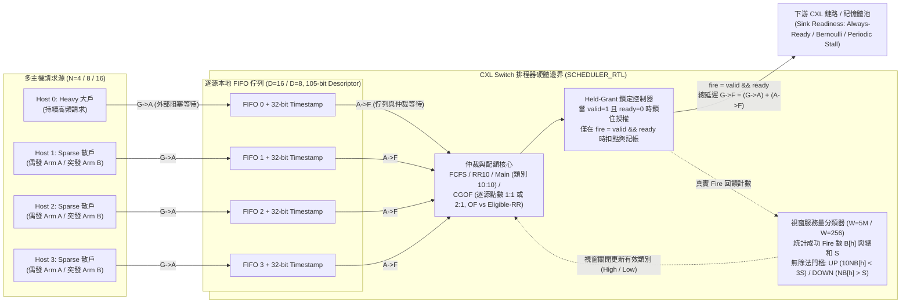
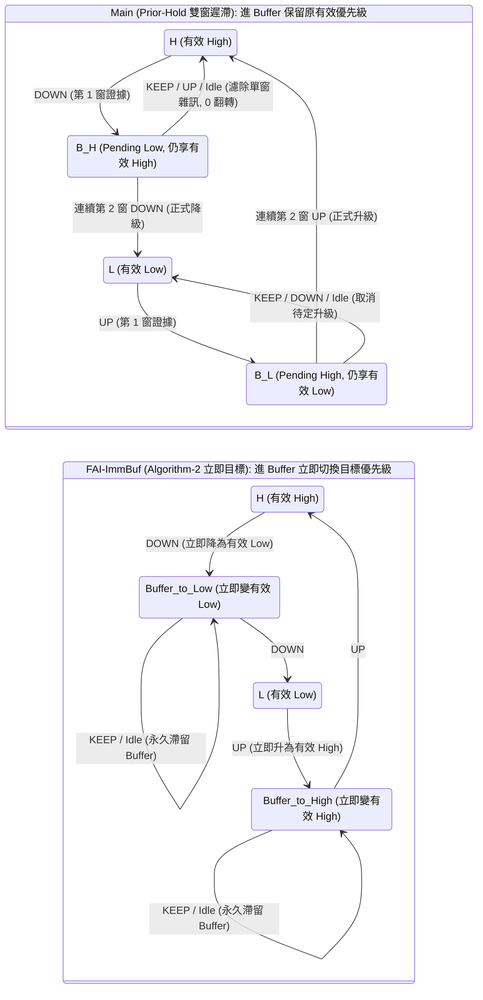
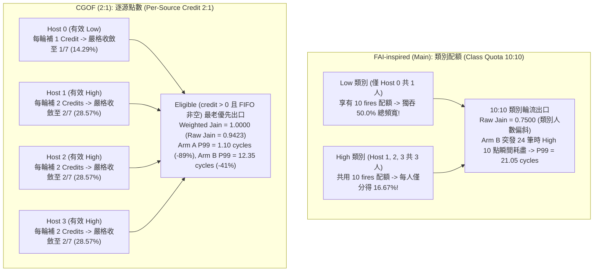
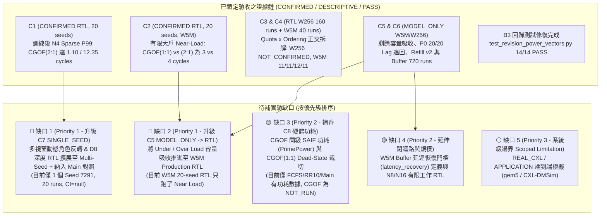

# 【大綱】CXL Switch 排程器專案（`cxl-scheduler`）完整故事梳理、架構圖解與待補實驗盤點

> **文件定位**：專案整體故事線與實驗證據大綱（Outline）
> **更新日期**：2026-11-02（涵蓋至 `main-v3.pdf` 定稿、`W5M` Production Ordering Campaign 與 `P0–P4 / R1–R7` 證據審查修補完成）
> **涵蓋範圍**：問題起點、硬體邊界契約、排程機制四幕演進史、Mermaid 視覺化架構圖解、以及後續實驗支持完整性檢查（Gap Analysis）。

---

## 一、故事起點：為什麼 CXL 記憶體池需要新的 Switch 排程器？

在 CXL（Compute Express Link）記憶體池化（Memory Pooling）架構中，多台伺服器主機（本研究涵蓋 `N=4, 8, 16` 個請求源）會透過 CXL Switch 共用遠端的記憶體池（詳見 `docs/final-report/sections/hotnets-body-v3.tex`）。這會在 Switch 的共用出口（Shared Egress）造成嚴重的**共用路徑擁塞（Shared-Path Contention）**：

* **大戶（Heavy Host）**：持續、密集地發送記憶體請求（例如每週期 1 筆或高機率請求），試圖把 Switch 出口塞滿。
* **散戶（Sparse Hosts）**：平常安靜，偶爾發送零星請求（**Arm A**：獨立隨機到達，機率 $1/128$）或小規模突發請求（**Arm B**：每 1,024 週期突發 8 筆請求）。

如果 Switch 出口單純按照「先來後到（`FCFS`）」排隊，散戶偶爾來一筆延遲敏感的請求，就必須排在大戶已經塞滿佇列的請求後面，造成嚴重的**隊頭阻塞（Head-of-Line Blocking）**與極高的 **P99 尾端延遲（Tail Latency）**。然而，若過度偏袒散戶，又可能打亂大戶的服務規律性（Service Regularity）或增加硬體面積與時序成本。

### 硬體評估邊界與延遲拆解（`SCHEDULER_RTL`）
為了在 Cycle-Accurate 的硬體邊界上公平對決各排程機制，專案建立了統一的單一出口（Single-Output）RTL 排程平台（見 `specs/CXL_SPEC.md` 與 `docs/final-report/sections/hotnets-body-v3.tex`）：
1. **本地佇列與統一 Descriptor**：每個來源主機擁有深度 $D=16$（另測 $D=8, 32$）的本地 FIFO，存放 **105-bit Descriptor**（32-bit Tag、32-bit Address、1-bit Opcode、8-bit Length、32-bit Payload）與選配的 **32-bit 到達時間戳（Timestamp）**。
2. **三段延遲恆等式**（每筆請求 $i$ 嚴格滿足 $L_{GF,i} = L_{GA,i} + L_{AF,i}$）：
   * **$\text{G}\to\text{A}$（Generation-to-Acceptance）**：請求產生後，因該主機本地 FIFO 已滿而在外部排隊等待進入 Switch 的週期數。
   * **$\text{A}\to\text{F}$（Acceptance-to-Fire）**：進入本地 FIFO 後，等待排程器選中並成功送出（Fire）的內部排隊週期數。
   * **$\text{G}\to\text{F}$（Generation-to-Fire）**：從產生到成功送出的總排程等待週期。
3. **Held-Grant（握住授權）硬體鐵律**：當排程器送出請求（`valid=1`）但下游鏈路忙碌（`ready=0`）時，**Hold 控制器必須鎖住（Latch）該筆已授權的請求與來源上下文**，直到 `ready=1` 完成握手（$\text{fire}(t) = v_{\text{out}}(t) \land r_{\text{out}}(t)$）才真正移除 FIFO 隊頭、扣除配額/點數並計入歷史服務量。Stall 期間新到達的請求絕對不能插隊搶走已發出的授權。

---

## 二、排程機制的四幕演進史

### 第一幕：傳統基準線（`FCFS`、`RR10`、`BLISS-inspired`）的侷限
* **`FCFS`（全域最老優先）**：散戶排在大戶深佇列後，在 20-seed N4 確認實驗中，散戶 $\text{G}\to\text{F}$ P99 在獨立到達（Arm A）高達 **`18.10` cycles**，突發到達（Arm B）更飆升至 **`33.45` cycles**。
* **`RR10`（輪詢，每次造訪最多連發 10 筆）**：完全不記歷史、也不用存 32-bit 時間戳，硬體面積最小（比 FCFS/Main 省約 **24%～28%**），且在 Arm B 突發下把散戶 P99 壓到 **`17.70` cycles**（Arm A 為 `11.00` cycles）。但它缺乏按請求年齡（Oldest-First）與歷史服務量動態保護散戶的能力。
* **`BLISS-inspired`（連續服務達 6 次即列入黑名單，每 10,000 cycles 清除）**：在 Arm A 獨立到達表現極佳（`1.15` cycles），但遇到 Arm B 突發（8 筆一組）時，散戶自身也會觸發黑名單門檻，導致 Arm B P99 退化回 **`33.00` cycles**。

---

### 第二幕：復刻 FAI-CXL 與揭開兩大盲點（Buffer 語意分歧 & 類別配額失衡）
專案首先將經典論文 **FAI-CXL** 實作成可綜合的硬體 RTL（稱為 **`Main` / `FAI-inspired`**）：

1. **無除法歷史分類器**：每個視窗 $W$（生產環境 $W=5{,}000{,}000$ cycles）結束時，統計各主機成功 Fire 數 $B[h]$ 與總和 $S=\sum B[h]$：
   * 服務量低於平均的 30%（$10NB[h] < 3S$）$\to$ 產生 **`UP`** 證據（傾向升為 `High` 優先級）。
   * 服務量高於平均（$NB[h] > S$）$\to$ 產生 **`DOWN`** 證據（傾向降為 `Low` 優先級）。
   * 介於中間 $\to$ **`KEEP`**。

2. **盲點一：FAI 論文內部的 Buffer 狀態機矛盾（`Main` vs. `FAI-ImmBuf` / `Algorithm-2`）**
   * FAI 論文正文 Section IV-C 描述進入過渡狀態 `Buffer` 時**保留原優先級一個視窗**；但該論文的 Algorithm 2 虛擬碼第 13/18 行卻在進入 `Buffer` 時**立即將 `P_last` 設為目標優先級**！
   * 我們將兩種詮釋都實作成硬體並進行 156 組開迴路（Transition-Only）與 720 組閉迴路（Closed-Loop）對照：
     * **`Main`（Prior-Hold 雙窗遲滯）**：4 狀態 `H, B_H, L, B_L`。從 `H` 收到第 1 個 `DOWN` 進入 `B_H` 時**仍享有 `High` 服務**，必須連續第 2 個視窗 `DOWN` 才正式降為 `L`；若單窗雜訊後遇到 `KEEP` 則退回 `H`（**單窗突波雜訊下有效類別翻轉 0 次**，代價是持續角色反轉時比單窗控制慢一個視窗穩定：W256 下 `448–704` vs. `192–448` cycles）。
     * **`FAI-ImmBuf`（歷史產物標記為 `Algorithm-2`，Immediate-Target）**：進入 Buffer 立即切換為目標優先級（單窗雜訊翻轉 2 次），且遇 `KEEP` 永久滯留於 Buffer。
     * **實證發現**：在 N4 20-seed 訓練後 RTL 確認中，`Main` 與 `FAI-ImmBuf` 的散戶 P99 幾乎相同（Arm A 皆為 `10.00` cycles；Arm B 為 `21.05` vs. `21.35` cycles），證明**分類器翻轉次數或穩定時間（Settle Delay）與排隊尾端延遲（Cohort Waiting P99）是不同物理量，不可直接畫上等號**。

3. **盲點二：為什麼 `Main` 在突發流量（Arm B）反而輸給簡單的 `RR10`（`21.05` vs. `17.70` cycles）？**
   * 根源在於 **`Main` 的配額單位是「類別（Class Quota 10:10）」而非「個別主機（Per-Source）」**！
   * 當 1 個大戶被分為 `Low`、3 個散戶被分為 `High`（`L/H/H/H`）時，`Main` 讓整個 `High` 類別拿 10 次服務、再讓整個 `Low` 類別拿 10 次服務：
     * **持續積壓下的嚴重不公平（Class-Size Skew）**：3 個 `High` 主機必須平分 `High` 類別的 50% 頻寬（每人僅分得 **$1/6 \approx 16.67\%$**），而唯一的 `Low` 主機卻獨吞整個 `Low` 類別的 **50%** 頻寬！導致 Raw Jain 公平性跌至 **`0.7500`**（L1 誤差 `0.50`）。
     * **突發到達下的配額耗盡**：當 3 個散戶同時各突發 8 筆請求（共 24 筆 `High` 請求）時，`High` 類別的 10 筆配額瞬間耗盡，剩下的 14 筆散戶請求被迫排隊等待 `Low` 大戶傳完 10 筆後才能繼續，直接把散戶 P99 推高到 `21.05` cycles！

---

### 第三幕：我們的破局設計——`CGOF`（Credit-Gated Oldest-First，逐源點數最老優先）
為了同時解決「類別人數不對稱造成的不公平」與「散戶突發排隊」，我們提出 **`CGOF`**（見 `docs/THEORY_ANALYSIS_AND_REVIEW_GAPS_2026-11-02.md`）：
* **核心改變：保留相同的視窗分類器，但將配額（Credit）直接綁定在「每一個獨立主機（Per-Source）」上**。
* 只要某主機的本地 FIFO 非空且手上有正點數（`credit > 0`），就進入**合格集合（Eligible Set）**，從中挑選最老的請求（`OF`）或輪流挑選（`Eligible-RR`）送出；每次成功 `fire` 扣該主機 1 點。
* 當所有活躍（FIFO 非空）主機都耗盡點數時，依其當前有效類別統一補點（Refill）：
  * **`CGOF (1:1)`**：所有主機每輪補 `1` 點（純逐源等權重控制組）。
  * **`CGOF (2:1)`**：有效 `High` 主機每輪補 `2` 點、有效 `Low` 主機每輪補 `1` 點。

#### `CGOF` 的四大實證突破與機制發現（對應 `docs/final-report/update-20261102/CLAIM_EVIDENCE_MATRIX_20261102.md`）：
1. **散戶尾端延遲斷層領先（Claim C1，`CONFIRMED`）**：
   * 在 20-seed 訓練後 N4 RTL 確認實驗（Seeds `529–548`）中，`CGOF (2:1)` 將散戶 $\text{G}\to\text{F}$ P99：
     * **Arm A（獨立到達）**：從 `Main` 的 `10.00` cycles 直接壓低至 **`1.10` cycles**（減少 `8.90` cycles，95% CI `[-9.00, -8.75]`，20/20 seeds 全勝）。
     * **Arm B（突發到達）**：從 `Main` 的 `21.05` cycles（及 `RR10` 的 `17.70`）壓低至 **`12.35` cycles**（減少 `8.70` cycles，95% CI `[-9.50, -7.90]`，20/20 seeds 全勝）。
2. **相對權重比相同 $\neq$ 短期尾端延遲相同（Claim C2，`CONFIRMED`）**：
   * 在 20-seed 有限大戶工作（500 萬筆 Heavy 請求，跨越 1 個 W5M 邊界）的 Near-Load RTL 確認實驗中，所有主機在越過第 1 個視窗後呈現 `B_H/H/H/H`，亦即**全部仍屬於有效 `High`（相對權重比完全相等）**。
   * 但每輪發 1 點的 **`CGOF (1:1)`** 比每輪發 2 點的 **`CGOF (2:1)`** 擁有更低的散戶 P99（**`3.00` vs. `4.00` cycles**，差值 `+1.00 [1.00, 1.00]`）與更小的大戶最大停頓間隔（**`9.45` vs. `10.85` cycles**，差值 `+1.40 [1.10, 1.75]`）。
   * 透過三層微觀追蹤（`cxl-credit-refill-trace-v2`）證實：**較大的絕對點數預算（2 點 vs. 1 點）允許主機在同一輪連發兩筆，拉長了 Refill 週期並改變散戶到達時遇到的剩餘點數與資格相位**。
3. **配額（Quota）是主導槓桿，合格集合內排序（`OF` vs. `Eligible-RR`）僅為 $\le 1$ cycle 的二階微調（Claims C3 & C4）**：
   * **W256 20-seed RTL 確認（Seeds `6501–6520`，160 runs）**：`Q1 (1:1)` 下 `RR - OF` 在 20/20 個 Seeds 全為 `0`；`Q2 (2:1)` 下僅 7/20 個 Seeds 改善 `-1` cycle、13/20 平手（平均 `-0.35` cycle），未達預註冊 15/20 門檻，正式判定為 **`NOT_CONFIRMED`**。
   * **W5M 5-seed Production RTL（Seeds `6601–6605`，40 runs，耗時 30.7 小時）**：5 個 Seeds 的散戶 P99 在 `Q1-OF / Q1-RR / Q2-OF / Q2-RR` 下**全部一致為 `11 / 11 / 12 / 11` cycles**（$d_1=0, d_2=-1, I=-1$）；但 `Eligible-RR` 在 `Q1` 下會讓大戶最壞停頓間隔（Max Wall Gap）平均惡化 **`+1.6` cycles**，且對大戶總完工時間毫無影響（10/10 比較差值為 `0`）。
4. **硬體面積與時序（SAED32 32nm Pre-Layout PPA）零違規且不膨脹**：
   * 在 `N4 / N8 / N16`、目標時脈週期 `25 ns`（40 MHz）下，6 組 `CGOF` 合成與 PrimeTime STA 全數 **0 違規通過**（Setup Slack 皆為正值）。
   * 在 N4 下，`CGOF (2:1)` 的完整 Cell Area 為 `109,794.8`，比 `Main` 的 `110,089.8` **還略小 `0.268%`**；`CGOF (1:1)` 更小了 **`3.567%`**（`106,163.1`）。

---

### 第四幕：回應嚴格證據審查（P0–P4 / R1–R7）與剩餘容量吸收理論
針對方法論審查提出的 7 大質疑（R1–R7，見 `docs/THEORY_ANALYSIS_AND_REVIEW_GAPS_2026-11-02.md`），專案已在 2026-10-30 至 2026-11-02 全數修補完畢並編入最終驗收報告 `docs/final-report/main-v3.pdf`（SHA-256: `27c51bb686faf4da0238e70af6a555f4027be0048238423c2a5e3e37f1b487cf`）：

* **剩餘容量吸收理論（Slack Absorption，修補 R1 / P0）**：
  * 審查者曾質疑：「大戶一完工就停止生成散戶，且排空（Drain）時強制 `ready=1`，是否掩蓋了散戶插隊對大戶的傷害？」
  * 我們導入與排程政策無關的**共同生成視野 $H$**，並沿用真實 `scenario.ready(k)` 排空：
    * **Under Load（未飽和）**：大戶 Mixed 與 Isolated 完工時間差在 20/20 個 W5M 模型 Seeds 中為 **`0.00` cycles（`[0.0, 0.0]`）**。
    * **Near Load（接近飽和，總需求率 $0.86 <$ 可用率 $0.90$）**：大戶中途雖會累積平均最多 **`5.00 / 4.95` 筆**的暫時落後（Transient Lag），但因散戶只是吸收大戶未產生請求的「空檔（Slack）」，在觀察期結束前 **20/20 全數追回**（Production RTL 20-seed 完工時間僅差 `3.05 / 3.00` cycles，比值 `1.00000048`）。
    * **Over Load（超載，總需求率 $>$ 可用率）**：空檔不敷使用，保護散戶才會轉化為大戶平均 **`+834.25` cycles**（`[820.4, 849.3]`，完工比 `1.03755`）的真實完工延遲代價。
* **誠實的科學定位（No Universal Winner）**：
  * 報告明確定位 `CGOF` 是**在「散戶尾端延遲保護 + 跨主機公平性 + 硬體面積成本」三大目標下的最佳綜合操作點**，同時誠實揭露三個邊界條件：(1) 超載時大戶最大單次停頓間隔增加 `1～2.55` cycles；(2) 若不需時間戳與分類，`RR10` 面積省 `24%～28%`；(3) 單一邊界全員有效 High 的 Near-Load 下，`CGOF (1:1)` 比 `(2:1)` 散戶尾端更低（`3 vs. 4` cycles）。

---

## 三、實驗支持完整性檢查：還有沒有缺的實驗支持？

根據 `docs/final-report/update-20261102/CLAIM_EVIDENCE_MATRIX_20261102.md`、`docs/final-report/update-20261102/ACCEPTANCE_20261102.md` 與 `docs/THEORY_ANALYSIS_AND_REVIEW_GAPS_2026-11-02.md` 的全面核對：

### 1. 對當前 15 頁定稿論文（`main-v3.pdf`）的阻斷性檢查：**0 阻斷缺口（All Clear）**
* **所有方法論審查漏洞（R1–R7 / P0–P4）皆已補齊**，且 24 個凍結產物的 SHA-256 皆由 `docs/final-report/generate_update_20261102.py` 自動驗證並綁定至 LaTeX 巨集。
* 先前在舊版筆記中提到的 `scripts/test_revision_power_vectors.py` 14 個測試錯誤，**已經修復完成並通過 `14/14 PASS`**（透過對齊 `POLICIES['fai-main'] = 'FAI-inspired'`，見 `docs/final-report/update-20261102/ACCEPTANCE_20261102.md`）。

### 2. 若要追求「頂會無懈可擊（Top-Tier Full Confirmation）」，目前仍可補齊的 4+1 項實驗缺口
在目前的證據矩陣中，`C7` 標記為 `SINGLE_SEED`、`C5/C6` 標記為 `MODEL_ONLY`、`C8` 標記為 `NOT_RUN`。若後續有算力時間要進一步消滅審查者挑剔的空間，建議按以下優先級補跑：

#### 🔴 第一優先（高投資報酬率、現有 RTL 平台可直接跑完）
1. **【缺口 1】多視窗動態適應、角色反轉（`[0,0,1,1]`）與 `D8` 深度的多種子 RTL 確認（將 `C7` 從 `SINGLE_SEED` 升級為 `CONFIRMED`）**
   * **目前缺口**：跨越 4 個 W5M 邊界（1,750 萬筆 Heavy 請求）、實體主機角色切換、Bursty vs. Spread 90% Readiness 與 `D8 vs. D16` 深度的動態 RTL 實驗（`cgof-dynamic-20261030`）目前**只有 1 個 Seed（`seed 7291`，20 runs，10 pairs，`CI: null`）**，且只測了 `CGOF (1:1)` 與 `CGOF (2:1)`，缺乏 `Main` 的同場多視窗有限工作 RTL 對照。
   * **建議補跑**：擴展至 **5～20 個獨立 Seeds**，並把 **`Main`（及 `RR10`）** 納入同一個 4-window 角色反轉 RTL 框架中。
2. **【缺口 2】將「Under / Near / Over Load 剩餘容量吸收」從 `MODEL_ONLY` 推進至 `W5M SCHEDULER_RTL`（將 `C5` 升級為 RTL 實證）**
   * **目前缺口**：證明「Under Load 完工差 `0` cycles、Over Load 完工差 `+834.25` cycles」的 20-seed W5M 確認實驗（Seeds `6201–6220`）目前是 **`MODEL_ONLY`**；而 W5M Production RTL 的 20-seed 有限工作確認（`C2`）只跑了 `near` 一種負載。
   * **建議補跑**：在 W5M Production RTL 上補跑 `under` 與 `over` 負載的 Mixed/Isolated 配對確認（5～20 seeds）。

#### 🟡 第二優先（補齊硬體功耗拼圖與延伸敏感度）
3. **【缺口 3】`CGOF` 的 SAED32 閘級 SAIF 功耗（PrimePower）與 `CGOF (1:1)` 無用分類器暫存器裁切（補齊 `C8`）**
   * **目前缺口**：SAED32 閘級功耗目前只跑了 `FCFS`（`3.356 mW`）、`RR10`（`2.560 mW`）與 `Main`（`3.467 mW`），**`CGOF` 的功耗仍為 `unmeasured / NOT_RUN`**。此外，`CGOF (1:1)` 網表中仍有 `23*(N+2)` 個未讀取的分類器暫存器（N4/N8/N16 各 138/230/414 個）尚未透過 RTL 參數裁切。
   * **建議補跑**：補跑 3-seed N4 `CGOF (1:1)` 與 `CGOF (2:1)` 的 PrimePower 閘級功耗，並提供 `CGOF (1:1)` 裁切分類器後的極致省面積/省電數據。
4. **【缺口 4】正式定義並實測 W5M Buffer「延遲恢復時間（`latency_recovery`）」與 `N8 / N16` 有限工作 RTL 擴展**
   * **目前缺口**：Buffer 閉迴路實驗（720 runs）目前在 `W256 MODEL_ONLY` 下執行，且 `latency_recovery` 標為 `NOT_DEFINED_THIS_ROUND`；`N8 / N16` 雖有完整 PPA/STA 面積時序數據，但尚未跑多視窗有限工作（Finite-Heavy）延遲分位數確認。

#### ⚪ 第三優先（系統級大工程，建議維持論文中之 Scoped Limitation / Future Work）
5. **【缺口 5】全系統 `REAL_CXL / APPLICATION` 端到端模擬（CXL.mem 協定、DRAM Bank 衝突與 CPU IPC Slowdown）**
   * **目前缺口**：目前所有實驗皆聚焦於 Switch 排程器的 Descriptor 邊界（`fire/cycle` 與 $\text{G}\to\text{F}$ cycles），尚未接入 `CXL-DMSim` 或 `gem5` 量測包含 DRAM 控制器、CXL.mem 雙向 Flit 與 Link Flow-Control Credit 的實際 Issue-to-Response 延遲與應用程式 IPC 減速比。現階段維持報告中誠實嚴謹的邊界聲明即可。
