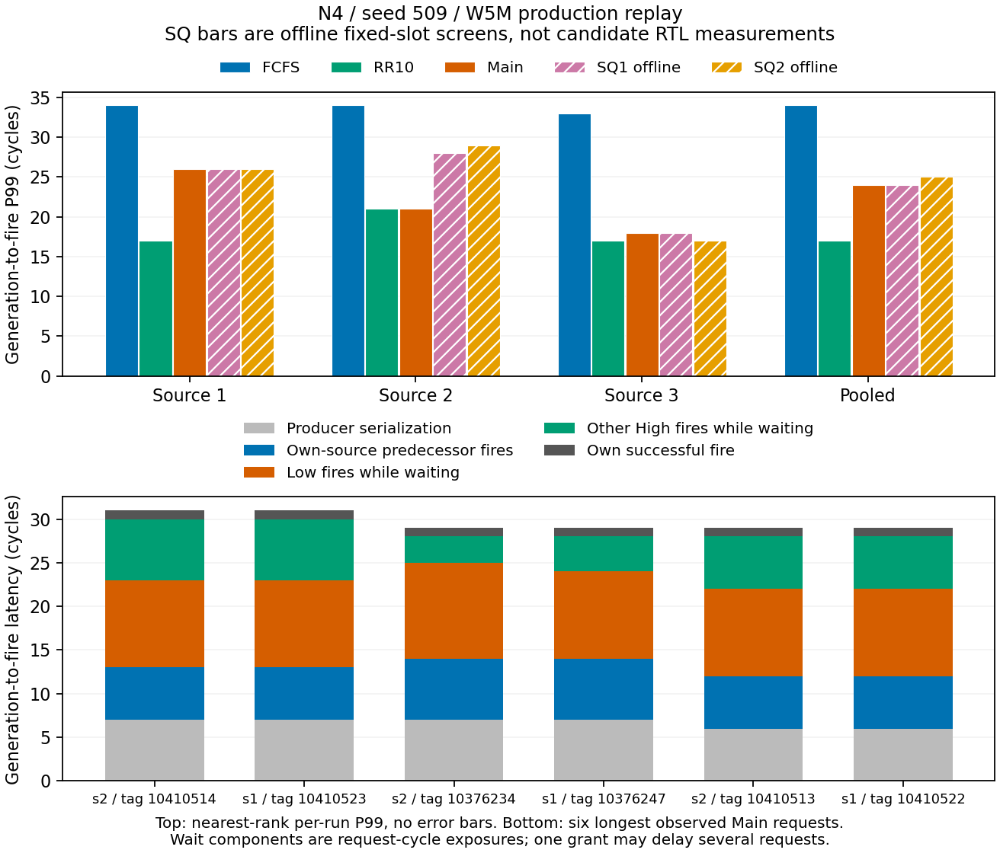

# Main-SQ performance comparison and design gate

Status: **baseline reproduction PASS; proposed SQ benefit gate FAIL**. Only FCFS, RR10
and accepted Main were executed as RTL. SQ1/SQ2 below are explicitly conditional offline
order-only screens. They are not additional simulated policies or measured hardware results.

## Comparable evidence and population

The [baseline diagnosis](BASELINE_DIAGNOSIS.md) independently reproduces all five original
seeds509–513. The new production replay is the representative seed509, N4/D16/M1,
descriptor105, RR quantum10, W5,000,000. Each policy runs10,000,000 real training cycles;
Main completes two production classification windows, with no state preload or time skip. Accepted Main reaches
L/H/H/H naturally and retains that map through A, B and their guards.

All three policies use the same intended descriptor/arrival traffic and ready1 sequence;
the external trace SHA256 is
`c6f0c7181bf9742fb585d2cb7375f94dcc0af13fc350b7b70dae781a1952875b`.
The [execution manifest](data/source_execution.json) records source revisions, exact traffic
configuration, canonical configuration hash, tools, commands and actual exits. Runtime
source is `3e457ccdfcdf0cbc2b2e9f380895b1c7d7b62e05`.

The B workload has100 blocks of1,024 cycles. Each sparse source generates an eight-request
batch at its seeded offset in every block:800/source,2,400 pooled. Heavy source0 continues
generating one descriptor/cycle. The B measurement lasts102,400 cycles, followed by a
1,024-cycle heavy-on guard. **All2,400 B-generated sparse requests complete while heavy
traffic remains active**, including spill into that guard. The final all-work drain is
separate and also completes heavy producer/FIFO/response backlog. No sparse latency is
discarded at the measurement cut.

Latency is direct generation-to-fire (G2F), with generation-to-acceptance (G2A) and
acceptance-to-fire (A2F) separately reconstructed from actual tags/pins. Percentiles use
nearest rank `ceil(p*K)`; stage percentiles are never added. Units are scheduler cycles.
Simulation cycle metrics do not substitute the25ns synthesis clock or imply application IPC.

## Actual RTL: representative burst case

| Policy | Sparse count | Mean G2F | P50 | P95 | P99 | Maximum | Mean A2F | A2F P99 |
| --- | ---: | ---: | ---: | ---: | ---: | ---: | ---: | ---: |
| FCFS |2,400|23.337917|24|30|34|38|19.837917|28|
| RR10 |2,400|9.273333|9|16|17|24|5.773333|14|
| Main |2,400|9.415000|9|16|24|31|5.915000|19|

| Policy | Source1 G2F P99 | Source2 G2F P99 | Source3 G2F P99 | Source1 A2F P99 | Source2 A2F P99 | Source3 A2F P99 |
| --- | ---: | ---: | ---: | ---: | ---: | ---: |
| FCFS |34|34|33|28|28|27|
| RR10 |17|21|17|10|17|10|
| Main |26|21|18|21|14|12|

Every policy/source has G2A mean3.5, P50=3 and P95=P99=max7: exactly100 requests at each
delay0…7/source. Sparse FIFO-full refusals are0 and maximum occupancy is8. This delay is
serial injection of the eight-descriptor batch, not sparse FIFO admission blockage.
All paired sparse tags have identical generation and acceptance times across policies.

Main beats FCFS on all2,400 paired G2F values. Relative to RR10,31 Main requests are
faster,2,315 tie and54 are slower. These within-run requests are correlated observations,
not2,400 independent experiments. The representative P99 is24, distinct from Main's
five-run mean P99 of20.8. The original five-seed result remains authoritative for that
aggregate; no confidence/significance claim is added by selecting this diagnostic case.

## Throughput, service and congestion

| B phase events | FCFS | RR10 | Main |
| --- | ---: | ---: | ---: |
| Intended/generated descriptors |104,800|104,800|104,800|
| Accepted descriptors |102,408|102,402|102,402|
| Completed transfers |102,400|102,400|102,400|
| Heavy transfers |100,007|100,001|100,001|
| Source1/2/3 transfers |793/800/800|799/800/800|799/800/800|
| Transfers / measured cycle |1.000000|1.000000|1.000000|
| Transfers / eligible-ready cycle |1.000000|1.000000|1.000000|
| Heavy service share |97.663086%|97.657227%|97.657227%|
| Heavy FIFO-full cycles |2,392|2,398|2,398|
| Heavy producer backlog at B end |239,902|239,908|239,908|

These are **phase event counts**, not the completion/admission fraction of the B-generated
cohort: earlier heavy backlog crosses the phase cuts, and some B sparse completions enter
the guard. N inputs can accept more than one descriptor per cycle; acceptance counts can
slightly exceed output transfers while FIFO occupancy changes. The full sparse cohort
count remains2,400 under every policy. All A/B measurement cycles are ready and eligible;
output stall cycles and avoidable bubbles are0. This does not describe all training/drain
cycles or real CXL link utilization.

Mean B FIFO occupancy is15.02336 for heavy FCFS and15.02342 for heavy RR/Main. Sparse
source1/2/3 means are0.15494/0.15460/0.15486 (FCFS),0.04437/0.04797/0.04297 (RR),
and0.04740/0.04743/0.04379 (Main). Heavy generation is deliberately overloaded and finite;
its backlog is not a stationary queue estimate. Heavy service share uses heavy fires /
all measured fires, not accepted or offered demand. Empty High visits surrender unused
credit, allowing heavy service far above50%.

Equal-share Jain fairness across these four unequally demanding sources would be
misleading. No new demand-normalized fairness estimate is claimed. Completing each
sparse cohort would trivially give completion-count Jain=1 and is not evidence of equal
latency or starvation freedom. Per-source tails are reported instead of hiding them.

## Offline SQ design screen: no measured RTL benefit

The [screen contract](MAIN_SQ_SPEC.md) keeps actual Main admissions, class membership,
High/Low service slots and total High capacity fixed, then rotates within High with
sub-quota1 or2. It rejects full-before-pop admission or unconsumable-slot inconsistencies.
This isolates the proposed ordering change under this case's fixed-class, ready1 conditions.

| G2F endpoint | Main actual RTL | SQ1 offline | SQ2 offline |
| --- | ---: | ---: | ---: |
| Pooled P99 |24|24|25|
| Mean |9.415|9.415|9.415|
| Maximum |31|34|34|
| Source1 P99 |26|26|26|
| Source2 P99 |21|28|29|
| Source3 P99 |18|18|17|

Every initial High pointer1/2/3 gives these results. The six settings are sensitivity
checks, not extra seeds. Equal pooled means follow algebraically from fixed admissions
and completion slots; they do not establish equal RTL behavior. SQ2 improves source3 by
one cycle while worsening source2 by eight and pooled P99 by one. SQ1 ties pooled P99
while worsening source2 by seven and maximum by three. Neither meets the proposed benefit
gate, and no hardware efficiency or single-request nonregression has been established
for either candidate. The W256 infrastructure screen also worsens P99 from23 to24/25;
it is not a substitute for production-W evidence.

The [editable SVG](diagnosis.svg) marks offline results explicitly. Waiting components are
overlapping request-cycle exposures, not disjoint scheduler slots or causal runtime shares.
The [baseline CDF](baseline_burst_tail.svg) shows actual seed509 RTL only. No error bar is
appropriate for this single diagnostic seed or the deterministic pointer sensitivities.

## Availability and limits

Raw distributions, joined examples and paired differences are in
[production_audit.json](data/production_audit.json); all populations/stages are exported in
[actual_latency.csv](data/actual_latency.csv). Screen output is separately labeled in
[screen_latency.csv](data/screen_latency.csv). The portable raw bundle and commands are
indexed in [README](README.md).

The five-policy matrix, multiple-heavy/all-saturated/dynamic/stalled SQ cases, SQ fairness
bounds and N8/16 SQ experiments are **NOT_RUN** following the conditional stop. Prior
baseline studies remain intact. This narrow screen does not rule out every SQ refill
rule, cold-state workload or future traffic pattern. It supports retaining the simpler
accepted baseline for this diagnosed extension rather than claiming a successful SQ design.
